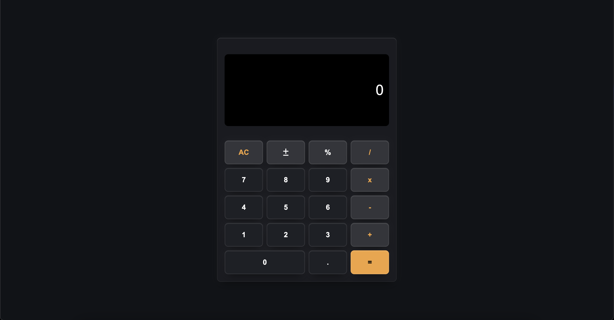

# odin-calculator: <a href="https://danielle-higgins.github.io/odin-calculator/" target="_blank">Visit Here</a>

If you are having a hard time doing some math in your head, then feel free to use my calculator! I used basic HTML, CSS, and JS to make this calculator functional. I had fun figuring out the logic and using a little of CSS grid to make the zero button span two columns. It's a nice challenge for a beginner!

## Tech Used

  
  
  

When building this project, I focused on making the JavaScript as easy to read as possible by separating functionality into functions. However, a lot of conditionals were used and can make the code a little harder to read.

## Optimizations

If/when I improve this project, I would like to add keyboard support as well as make my code a lot more cleaner and easier to read.

## Lessons Learned:

I got a refresher on DOM manipulation and events as well as learned a little of CSS grid.
